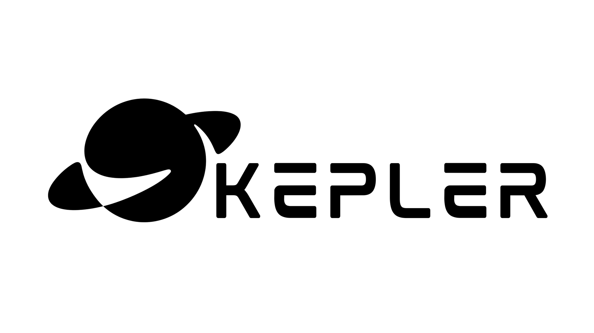

# Kepler

<p align="center">
  
</p>

<p align="center">
  
</p>

<p align="center">
  <strong>Teaching a rocket to land itself.</strong><br>
  <em>A 6-DOF retro-propulsion simulator, a classical flight computer, and a neural landing controller, all in one sandbox you can fly in your browser.</em>
</p>

<p align="center">
  <a href="#quick-start">Quick Start</a> •
  <a href="#benchmark-results">Benchmarks</a> •
  <a href="#how-a-landing-works">How a Landing Works</a> •
  <a href="#physics-engine-architecture">Physics Core</a> •
  <a href="#kepler-1-controller">Kepler-1 Agent</a> •
  <a href="#the-3d-sandbox">3D Sandbox</a> •
  <a href="#license">License</a>
</p>

---

## Overview

Landing an orbital-class booster upright on a ship in the middle of the ocean is one of the most impressive things modern engineering does. **Kepler** is our attempt to understand that problem from the ground up, and to see how far a learned controller can take it.

Kepler is an open-source flight dynamics sandbox and autonomous landing controller, inspired by reusable boosters like the SpaceX Falcon 9. It gives you:

- **A full 6-DOF physics engine.** Rigid-body dynamics with changing mass and inertia, quaternion attitude, aerodynamic drag, and gusting wind.
- **Kepler-1, a neural landing agent.** It flies the booster from a few hundred metres up all the way to a soft, upright touchdown.
- **A classical flight computer** to compare against: a hand-tuned cascaded guidance and control system.
- **A real-time 3D sandbox.** Watch, tweak, and even fly the landing yourself, right in your browser.

### Why this is hard

A landing booster is nothing like a helicopter, and it can't take its time:

- **It can't hover.** Even at its lowest throttle, the engine pushes harder than gravity pulls ($TWR > 1$). If the engine stays lit, the rocket starts going back *up*.
- **Fuel is tight.** Every second of burning costs propellant the booster may not have.
- **The dynamics are unforgiving.** The system is highly nonlinear, wind keeps pushing it sideways, and the engine produces so much torque that small mistakes turn into big tumbles.

The answer is the **hoverslam**, often called the *suicide burn*. The booster falls with its engine off for as long as it dares, then lights it at exactly the right moment, so that its velocity hits zero just as the legs touch the deck. Too early and it wastes fuel (or climbs away); too late and it hits hard. In the meantime it has to steer its engine (thrust vector control) and fire nitrogen cold-gas thrusters to stay upright and drift onto the target, whether that's a ground pad or an Autonomous Spaceport Drone Ship (ASDS) barge.

---

## Benchmark Results

We put Kepler-1 through **30 randomised flights**, each with a different starting setup:

- Initial altitude between **180 m and 300 m**
- Cross-track offset of up to **±20 m** from the pad
- Descent velocity between **−15 and −25 m/s**
- Randomised initial attitude errors

| Metric | Target Specification | **Kepler-1 Neural Agent** | Status |
| :--- | :--- | :--- | :---: |
| **Touchdown Success Rate** | 100.0% (30/30) | **100.0%** (30/30) | ✅ **PASSED** |
| **Touchdown Velocity ($v_z$)** | $< 2.0\text{ m/s}$ | **$-1.24\text{ m/s}$** | ✅ **PASSED** |
| **Pad Radial Dispersion** | $< 15.0\text{ m}$ (ASDS Deck) | **$4.98\text{ m}$** (ASDS Deck) | ✅ **PASSED** |
| **Upright Attitude Tilt** | $< 5.0^\circ$ | **$0.09^\circ$** (Precision Vertical) | ✅ **PASSED** |
| **Propellant Conserved** | $> 2,000\text{ kg}$ reserve | **$5,537.0\text{ kg}$** / 8,000 kg (69.2% Conserved) | ✅ **PASSED** |
| **Terminal Hovering** | None (Direct descent) | **0.00 s** (Direct hoverslam flare) | ✅ **PASSED** |

**What these numbers mean in plain terms:** every one of the 30 flights landed. On average the booster touched down at about walking pace, roughly 5 m from the centre of the deck, standing almost perfectly straight, with more than two thirds of its landing fuel left over. It never hovered, either: each landing was a single, committed burn.

> [!NOTE]
> All benchmarks were conducted with standard physics constraints: dry mass 25,000 kg, initial landing fuel 8,000 kg, Merlin 1D max thrust 845 kN, minimum throttle 40%, 10° TVC gimbal limit, and continuous aerodynamic drag. In addition, Kepler-1 successfully demonstrated 100% touchdown reliability across multi-altitude sandbox drops ranging from 120 m to 800 m under active wind gusts.

---

## Quick Start

### 1. Install

You'll need **Python 3.10 or newer**. Clone the repo and install it in editable mode:

```bash
git clone https://github.com/finkkle/kepler.git
cd kepler
pip install -e .
```

This pulls in everything Kepler depends on: PyTorch, Gymnasium, Stable-Baselines3, FastAPI, Uvicorn, and NumPy.

> [!TIP]
> Consider using a virtual environment (`python -m venv .venv`) so Kepler's dependencies don't clash with your other projects.

### 2. Launch the 3D sandbox

This is the fun part. Start the local simulation server:

```bash
python scripts/run_sandbox.py
```

Then open **[http://127.0.0.1:8000](http://127.0.0.1:8000)** in your browser. You should see the booster high above the drone ship, ready to drop. See [The 3D Sandbox](#the-3d-sandbox) for what you can do there.

### 3. Run the benchmark

Want to check our numbers? This runs the pre-trained Kepler-1 agent through the same 30 randomised flights:

```bash
python scripts/evaluate_kepler1.py
```

You'll get a scorecard at the end, in the same shape as the table above.

### 4. Train Kepler-1 yourself

To train Kepler-1 from scratch using the balanced imitation learning pipeline:

```bash
python scripts/train_kepler1.py
```

The pre-trained weights in `checkpoints/` are what the sandbox and benchmark use by default, so you don't need to train anything to get started.

---

## How a Landing Works

Every Kepler landing follows the same basic story:

1. **The drop.** The booster starts high above the pad, already falling fast, usually off to one side and a little tilted.
2. **The coast.** With the engine off, it falls freely. Kepler-1 uses this time to read the situation: how high, how fast, how far off target, how much the wind is pushing.
3. **Ignition.** At the last sensible moment, the engine lights. Because the booster can't hover, the timing of this single moment decides almost everything.
4. **The flare.** Throttle, engine gimbal, and cold-gas thrusters work together to kill the vertical speed, null out sideways drift, and bring the booster upright over the target.
5. **Touchdown.** Velocity reaches (nearly) zero right as the legs meet the deck, and the engine cuts off.

---

## The 3D Sandbox

The sandbox is where Kepler comes alive. It's a Three.js scene running at 60 FPS in your browser, fed by live telemetry from the physics engine.

**Flight modes**: switch any time between:

| Mode | Who's flying |
| :--- | :--- |
| `RL Agent (Kepler-1)` | The trained neural controller |
| `Classical Flight Computer` | The hand-tuned cascaded guidance and control system |
| `Manual Flight` | You. Good luck. |
| `Free Fall` | Nobody. A useful reminder of why this is hard. |

**Live parameter controls**: change altitude, horizontal offset, wind gust speed, and propellant reserves in real time, and see how each controller copes.

**Camera views**: chase cam, drone ship deck view, free orbit cam, and ground tracking cam.

> [!TIP]
> A good first experiment: run the same drop with the Classical Flight Computer and then with Kepler-1, and compare how they each handle the flare.

---

## Physics Engine Architecture

We wanted Kepler to run smoothly at 60 FPS on an ordinary laptop, without needing a dedicated GPU. To get there, we split the work into two halves: the heavy number-crunching happens in Python, and the browser only has to draw what it's told.

```
[ Vectorized 6-DOF Physics Core ]  (~4,500 steps/sec/core, RK4 Integrator)
               │
               ▼
   [ Kepler-1 RL Policy / Gym ]    (Gymnasium `KeplerLanding-v1` Environment)
               │
               ▼ 50 Hz WebSocket Telemetry Stream
   [ 3D WebGL / Three.js Sandbox ] (Smooth hardware-accelerated client UI)
```

1. **The physics core** integrates the equations of motion with a fourth-order Runge–Kutta (RK4) integrator, at roughly 4,500 steps per second per CPU core.
2. **The controller layer** wraps the physics in a standard Gymnasium environment, `KeplerLanding-v1`, so any controller (Kepler-1, the flight computer, or your own) talks to it the same way.
3. **The sandbox** receives a 50 Hz telemetry stream over WebSocket and renders it with hardware-accelerated WebGL.

### 1. Equations of Motion

The booster is modelled as a **6-DOF rigid body**: three axes of movement and three of rotation. As it burns fuel, both its mass $m(t)$ and its moment of inertia tensor $\mathbf{I}(t)$ change. Attitude is tracked with quaternions $\mathbf{q} = [q_w, q_x, q_y, q_z]^T$, which avoids the gimbal lock you'd get with Euler angles.

Translational motion (position and velocity):

$$\dot{\mathbf{p}} = \mathbf{v}, \quad \dot{\mathbf{v}} = \frac{1}{m} \left( \mathbf{F}_{\text{thrust}} + \mathbf{F}_{\text{aero}} \right) + \mathbf{g}$$

Rotational motion (attitude and angular rate):

$$\dot{\mathbf{q}} = \frac{1}{2} \mathbf{q} \otimes \begin{bmatrix} 0 \\ \boldsymbol{\omega} \end{bmatrix}, \quad \dot{\boldsymbol{\omega}} = \mathbf{I}^{-1} \left( \boldsymbol{\tau}_{\text{total}} - \boldsymbol{\omega} \times (\mathbf{I} \boldsymbol{\omega}) \right)$$

### 2. Aerodynamics & Environment

The air isn't just empty space here; it pushes back.

- **Atmospheric density** follows the U.S. Standard Atmosphere model, thinning out with altitude: $\rho(z) = \rho_0 \exp(-z / H)$.
- **Aerodynamic drag** is resolved across the body, with a nominal centre of pressure $z_{cp}$ that creates restoring moments:

  $$\mathbf{F}_{\text{drag}} = -\frac{1}{2} \rho \|\mathbf{v}_{\text{rel}}\|^2 C_D A \cdot \hat{\mathbf{v}}_{\text{rel}}$$

- **Wind** combines a steady logarithmic boundary-layer shear (wind gets stronger with height) with randomised Dryden gust turbulence, so no two flights feel quite the same.

### 3. Cascaded Flight Control System (FCS)

Here's a problem we ran into early: the engine is *too* good at turning the rocket. Thrust vectoring produces enormous control torque ($\approx 17\times 10^6\text{ N}\cdot\text{m}$), so a controller that pokes at the gimbal directly while it's still learning just sends the booster tumbling.

The fix is a **cascaded** design, two loops stacked on top of each other:

- **Outer guidance loop**: decides *where the rocket should be leaning*. It commands desired bank angles $(\theta_p^*, \theta_r^*)$ to steer the lateral velocity toward the pad centre $(0, 0)$.
- **High-bandwidth inner loop**: makes the rocket *actually lean that way*. It turns attitude error into TVC gimbal deflections $(\delta_y, \delta_z)$ using PD feedback:

  $$\delta_y = \text{clip}(k_p (\theta_p - \theta_p^*) + k_d \omega_y, -\delta_{\max}, \delta_{\max})$$

The inner loop keeps the booster stable no matter what, which lets the outer layer (whether that's Kepler-1 or the classical flight computer) think in terms of "lean a bit left" rather than raw engine angles.

---

## Kepler-1 Controller

Kepler-1 is the neural network that flies the booster. Every control step, it looks at the state of the rocket and decides what to do with the engine and thrusters.

### What it sees: observation space (17 dimensions)

| # | Input | Values | Why it matters |
| :--- | :--- | :--- | :--- |
| 1 | **Normalized Position** | $[x/100, y/100, z/500]$ | Where the booster is relative to the pad |
| 2 | **Normalized Velocity** | $[v_x/50, v_y/50, v_z/50]$ | How fast it's moving, and in which direction |
| 3 | **Attitude Quaternion** | $[q_w, q_x, q_y, q_z]$ | Which way it's pointing |
| 4 | **Angular Rates** | $[\omega_x, \omega_y, \omega_z]$ | How fast it's rotating |
| 5 | **Tilt Angle** | $\theta_{\text{tilt}}$ (radians from local vertical) | How far it is from standing straight |
| 6 | **Propellant Fraction** | $m_{\text{fuel}} / m_{\text{fuel,0}}$ | How much fuel it has left to work with |
| 7 | **Local Crosswind** | $[w_x/20, w_y/20]$ | What the wind is doing to it |

Positions, velocities, and wind are scaled down so that every input lands in a similar range, which makes learning much more stable.

### What it controls: action space (4 continuous dimensions in $[-1, 1]$)

| Action | Controls | Details |
| :--- | :--- | :--- |
| $a_0$ | **Throttle** | Scales linearly from $0.40$ to $1.0$; values $\le 0.0$ command engine cutoff |
| $a_1$ | **Target pitch tilt** | Mapped to a $[-16^\circ, +16^\circ]$ bank angle |
| $a_2$ | **Target roll tilt** | Mapped to a $[-16^\circ, +16^\circ]$ bank angle |
| $a_3$ | **RCS roll torque** | Nitrogen cold-gas thrusters for roll damping |

Notice that Kepler-1 doesn't move the engine gimbal directly. It asks for a *lean*, and the inner control loop described above takes care of the rest.

### What it's rewarded for: multi-objective reward function

$$\mathcal{R} = r_{\text{fuel}} + r_{\text{tilt}} + r_{\boldsymbol{\omega}} + r_{\text{dist}} + r_{\text{glideslope}} + R_{\text{terminal}}$$

Each term nudges the agent toward a different part of a good landing:

- $r_{\text{fuel}} = -\alpha \Delta m_{\text{fuel}}$ penalises burning fuel, which directly rewards coasting and a late, efficient suicide burn.
- $r_{\text{tilt}} = -1.2 \theta_{\text{tilt}}^2$ keeps the booster upright, punishing large tilts much more than small ones.
- $r_{\boldsymbol{\omega}}$ discourages spinning and wobbling.
- $r_{\text{dist}}$ pulls the booster toward the pad.
- $r_{\text{glideslope}}$ encourages a sensible descent profile on the way down.
- $R_{\text{terminal}} = +600 + 400 \frac{m_{\text{fuel}}}{m_0} + 100(1 - d/r_{\text{pad}}) + 100(1 - |v_z|/v_{\max})$ is the big payoff for a successful soft touchdown, with bonuses for fuel left over, landing close to the centre, and touching down gently.

---

## Repository Structure

```
kepler/
├── assets/                       # Branding logos and web banners
│   ├── kepler-logo.png
│   ├── kepler-banner.png
│   └── kepler-banner-web.png
├── checkpoints/                  # Trained neural network weights
│   ├── kepler_1.zip              # Pre-trained Kepler-1 Actor-Critic policy
│   └── kepler_1_bc.zip           # Behavioral cloning baseline checkpoint
├── kepler/
│   ├── config.py                 # Falcon 9 booster constants and simulation config
│   ├── controllers/
│   │   └── flight_computer.py    # Classical cascaded autonomous flight computer
│   ├── envs/
│   │   └── landing_env.py        # Gymnasium KeplerLanding-v1 environment
│   ├── physics/
│   │   ├── atmosphere.py         # U.S. Standard Atmosphere model
│   │   ├── dynamics.py           # 6-DOF RK4 rigid-body equations of motion
│   │   ├── quaternion.py         # Quaternion algebra and Euler conversions
│   │   └── wind.py               # Boundary layer shear and Dryden gust models
│   └── sim3d/
│       ├── server.py             # FastAPI WebSocket telemetry stream server
│       └── static/
│           └── index.html        # Three.js 3D WebGL interactive sandbox UI
├── scripts/
│   ├── evaluate_kepler1.py       # 30-flight benchmark evaluation scorecard
│   ├── run_sandbox.py            # Local 3D simulation server launcher
│   ├── test_all_sandbox_altitudes.py # Multi-altitude drop verification suite (120m-800m)
│   ├── test_baseline.py          # Baseline physics sanity tests
│   ├── test_fc_30.py             # 30-flight flight computer benchmark
│   └── train_kepler1.py          # End-to-end training pipeline
├── pyproject.toml                # Project metadata and package configuration
├── .gitignore                    # Git tracking rules
└── README.md                     # Technical documentation
```

**Where to start reading:** if you're curious about the physics, open `kepler/physics/dynamics.py`. If you want to tweak the booster itself (mass, thrust, gimbal limits), everything lives in `kepler/config.py`. And if you want to see how the agent experiences the world, `kepler/envs/landing_env.py` is the place.

---

## Testing

Beyond the main benchmark, the `scripts/` folder includes a few extra checks:

```bash
# Basic physics sanity checks
python scripts/test_baseline.py

# Benchmark the classical flight computer over 30 flights
python scripts/test_fc_30.py

# Drop tests from 120 m to 800 m across the sandbox's altitude range
python scripts/test_all_sandbox_altitudes.py
```

---

## Contributing

Found a bug, have an idea for a better controller, or want to make the physics more realistic? We'd love the help. Have a read of our [contributing guide](https://github.com/finkkle/.github/blob/main/CONTRIBUTING.md) to get started, and open an issue before starting on anything big so we can talk it through.

---

## Acknowledgements

Kepler is inspired by the incredible real-world work on reusable rockets, particularly SpaceX's Falcon 9 landings. Kepler is an independent project and is not affiliated with or endorsed by SpaceX. Vehicle parameters are approximations for simulation purposes only.

---

## License

This project is licensed under the [Apache License 2.0](LICENSE) - Copyright (c) 2026 finkkle.

<div align="center">

<br>

Built by <a href="https://github.com/finkkle">Finkkle</a>.

</div>
