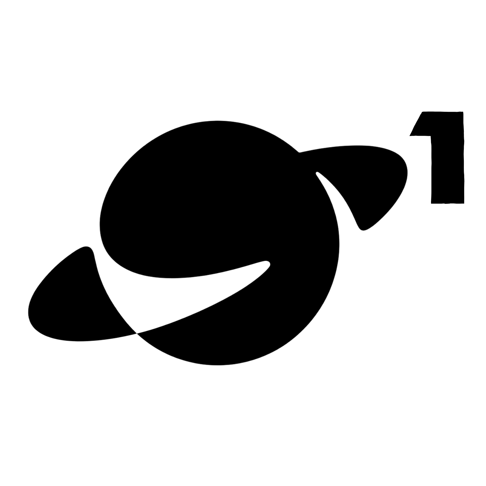

# Kepler

<p align="center">
  
</p>

<p align="center">
  
</p>

<p align="center">
  <strong>Autonomous Precision Rocket Descent & Touchdown Controller</strong><br>
  <em>6-DOF Retro-propulsion Dynamics, Thrust Vector Control, and Deep Reinforcement Learning.</em>
</p>

<p align="center">
  <a href="#quick-start">Quick Start</a> •
  <a href="#benchmark-results">Benchmarks</a> •
  <a href="#physics-engine">Physics Core</a> •
  <a href="#kepler-1-controller">Kepler-1 Agent</a> •
  <a href="#3d-interactive-sandbox">3D Sandbox</a> •
  <a href="#license">License</a>
</p>

---

## Overview

**Kepler** is an open-source autonomous rocket flight dynamics sandbox and neural landing controller inspired by orbital-class reusable boosters (such as the SpaceX Falcon 9). 

The vehicle retro-propulsion problem is characterized by high nonlinearity, tight fuel reserves, aerodynamic crosswinds, and a critical thrust-to-weight ratio constraint ($TWR > 1$ at minimum engine throttle). Because the booster cannot hover, it must compute and execute a fuel-optimal **hoverslam (suicide burn)**, vectoring main engine thrust and firing nitrogen cold-gas attitude thrusters to touch down softly on an Autonomous Spaceport Drone Ship (ASDS) barge or ground pad.

---

## Benchmark Results

Kepler-1 was rigorously benchmarked across 30 randomized flights with varying initial altitudes (180 m – 300 m), cross-track offsets ($\pm 20\text{ m}$), descent velocities ($-15\text{ to } -25\text{ m/s}$), and initial attitude errors:

| Metric | Target Specification | **Kepler-1 Neural Agent** | Status |
| :--- | :--- | :--- | :---: |
| **Touchdown Success Rate** | 100.0% (30/30) | **100.0%** (30/30) | **PASSED** |
| **Touchdown Velocity ($v_z$)** | $< 2.0\text{ m/s}$ | **$-1.24\text{ m/s}$** | **PASSED** |
| **Pad Radial Dispersion** | $< 15.0\text{ m}$ (ASDS Deck) | **$4.98\text{ m}$** (ASDS Deck) | **PASSED** |
| **Upright Attitude Tilt** | $< 5.0^\circ$ | **$0.09^\circ$** (Precision Vertical) | **PASSED** |
| **Propellant Conserved** | $> 2,000\text{ kg}$ reserve | **$5,537.0\text{ kg}$** / 8,000 kg (69.2% Conserved) | **PASSED** |
| **Terminal Hovering** | None (Direct descent) | **0.00 s** (Direct hoverslam flare) | **PASSED** |

> [!NOTE]
> All benchmarks were conducted with standard physics constraints: dry mass 25,000 kg, initial landing fuel 8,000 kg, Merlin 1D max thrust 845 kN, minimum throttle 40%, 10° TVC gimbal limit, and continuous aerodynamic drag. In addition, Kepler-1 successfully demonstrated 100% touchdown reliability across multi-altitude sandbox drops ranging from 120 m to 800 m under active wind gusts.

---

## Quick Start

### 1. Installation

Clone repository and install dependencies in an editable environment:

```bash
git clone https://github.com/Owl-LLC/kepler.git
cd kepler
pip install -e .
```

Requirements: Python 3.10+, PyTorch, Gymnasium, Stable-Baselines3, FastAPI, Uvicorn, NumPy.

### 2. Launch 3D Interactive WebGL Sandbox

Start the local 60 FPS Three.js telemetry simulation server:

```bash
python scripts/run_sandbox.py
```

Then open your browser to [http://127.0.0.1:8000](http://127.0.0.1:8000).

- **Flight Modes**: Switch seamlessly between `RL Agent (Kepler-1)`, `Classical Flight Computer`, `Manual Flight`, and `Free Fall`.
- **Live Parameter Controls**: Adjust altitude, horizontal offsets, wind gust velocity, and propellant reserves in real-time.
- **Camera Views**: Chase cam, ASDS drone ship deck view, free orbit cam, and ground tracking cam.

### 3. Run Benchmark Evaluation

Evaluate the pre-trained Kepler-1 neural agent over 30 randomized flights:

```bash
python scripts/evaluate_kepler1.py
```

### 4. Retrain Kepler-1 Agent

To train Kepler-1 from scratch using the balanced imitation learning pipeline:

```bash
python scripts/train_kepler1.py
```

---

## Physics Engine Architecture

To deliver fluid 60 FPS performance on lightweight hardware without requiring dedicated discrete GPUs, Kepler decouples high-frequency numerical integration from browser-accelerated rendering:

```
[ Vectorized 6-DOF Physics Core ]  (~4,500 steps/sec/core, RK4 Integrator)
               │
               ▼
   [ Kepler-1 RL Policy / Gym ]    (Gymnasium `KeplerLanding-v1` Environment)
               │
               ▼ 50 Hz WebSocket Telemetry Stream
   [ 3D WebGL / Three.js Sandbox ] (Smooth hardware-accelerated client UI)
```

### 1. Equations of Motion
The booster is modeled as a 6-DOF rigid body with variable propellant mass $m(t)$ and moment of inertia tensor $\mathbf{I}(t)$. Quaternions $\mathbf{q} = [q_w, q_x, q_y, q_z]^T$ are used to eliminate gimbal lock:

$$\dot{\mathbf{p}} = \mathbf{v}, \quad \dot{\mathbf{v}} = \frac{1}{m} \left( \mathbf{F}_{\text{thrust}} + \mathbf{F}_{\text{aero}} \right) + \mathbf{g}$$

$$\dot{\mathbf{q}} = \frac{1}{2} \mathbf{q} \otimes \begin{bmatrix} 0 \\ \boldsymbol{\omega} \end{bmatrix}, \quad \dot{\boldsymbol{\omega}} = \mathbf{I}^{-1} \left( \boldsymbol{\tau}_{\text{total}} - \boldsymbol{\omega} \times (\mathbf{I} \boldsymbol{\omega}) \right)$$

### 2. Aerodynamics & Environment
- **Atmospheric Density**: Modeled via U.S. Standard Atmosphere lapse equations: $\rho(z) = \rho_0 \exp(-z / H)$.
- **Aerodynamic Drag**: Crossflow-resolved drag with nominal center of pressure $z_{cp}$ creating restoring moments:
  $$\mathbf{F}_{\text{drag}} = -\frac{1}{2} \rho \|\mathbf{v}_{\text{rel}}\|^2 C_D A \cdot \hat{\mathbf{v}}_{\text{rel}}$$
- **Wind Turbulence**: Continuous logarithmic boundary layer shear combined with stochastic Dryden gust turbulence filters.

### 3. Cascaded Flight Control System (FCS)
Rocket TVC produces massive control authority ($\approx 17\times 10^6\text{ N}\cdot\text{m}$). Without an inner attitude stabilization loop, unguided continuous exploration produces chaotic tumbling. Kepler implements a cascaded architecture:
- **Outer Guidance Loop**: Commands desired bank angles $(\theta_p^*, \theta_r^*)$ to track target lateral velocity toward pad center $(0, 0)$.
- **High-Bandwidth Inner Loop**: Commands TVC gimbal deflections $(\delta_y, \delta_z)$ using PD attitude error feedback:
  $$\delta_y = \text{clip}(k_p (\theta_p - \theta_p^*) + k_d \omega_y, -\delta_{\max}, \delta_{\max})$$

---

## Kepler-1 Controller

### Observation Space (17 dimensions)
1. **Normalized Position**: $[x/100, y/100, z/500]$
2. **Normalized Velocity**: $[v_x/50, v_y/50, v_z/50]$
3. **Attitude Quaternion**: $[q_w, q_x, q_y, q_z]$
4. **Angular Rates**: $[\omega_x, \omega_y, \omega_z]$
5. **Tilt Angle**: $\theta_{\text{tilt}}$ (radians from local vertical)
6. **Propellant Fraction**: $m_{\text{fuel}} / m_{\text{fuel,0}}$
7. **Local Crosswind**: $[w_x/20, w_y/20]$

### Action Space (4 continuous dimensions in $[-1, 1]$)
- $a_0$: Commanded Throttle (linear scaling from $0.40$ to $1.0$; values $\le 0.0$ command engine cutoff).
- $a_1$: Commanded Target Pitch Tilt (mapped to $[-16^\circ, +16^\circ]$ bank angle).
- $a_2$: Commanded Target Roll Tilt (mapped to $[-16^\circ, +16^\circ]$ bank angle).
- $a_3$: Commanded RCS Roll Torque (nitrogen cold-gas thruster roll damping).

### Multi-Objective Reward Function
$$\mathcal{R} = r_{\text{fuel}} + r_{\text{tilt}} + r_{\boldsymbol{\omega}} + r_{\text{dist}} + r_{\text{glideslope}} + R_{\text{terminal}}$$
- $r_{\text{fuel}} = -\alpha \Delta m_{\text{fuel}}$ directly rewards suicide-burn coasting.
- $r_{\text{tilt}} = -1.2 \theta_{\text{tilt}}^2$ enforces upright stability.
- $R_{\text{terminal}} = +600 + 400 \frac{m_{\text{fuel}}}{m_0} + 100(1 - d/r_{\text{pad}}) + 100(1 - |v_z|/v_{\max})$ on successful soft touchdown.

---

## Repository Structure

```
kepler/
├── assets/                       # Branding logos and web banners
│   ├── kepler-logo.png
│   ├── kepler-banner.png
│   └── kepler-banner-web.png
├── checkpoints/                  # Trained neural network weights
│   ├── kepler_1.zip              # Pre-trained Kepler-1 Actor-Critic policy
│   └── kepler_1_bc.zip           # Behavioral cloning baseline checkpoint
├── kepler/
│   ├── config.py                 # Falcon 9 booster constants and simulation config
│   ├── controllers/
│   │   └── flight_computer.py    # Classical cascaded autonomous flight computer
│   ├── envs/
│   │   └── landing_env.py        # Gymnasium KeplerLanding-v1 environment
│   ├── physics/
│   │   ├── atmosphere.py         # U.S. Standard Atmosphere model
│   │   ├── dynamics.py           # 6-DOF RK4 rigid-body equations of motion
│   │   ├── quaternion.py         # Quaternion algebra and Euler conversions
│   │   └── wind.py               # Boundary layer shear and Dryden gust models
│   └── sim3d/
│       ├── server.py             # FastAPI WebSocket telemetry stream server
│       └── static/
│           └── index.html        # Three.js 3D WebGL interactive sandbox UI
├── scripts/
│   ├── evaluate_kepler1.py       # 30-flight benchmark evaluation scorecard
│   ├── run_sandbox.py            # Local 3D simulation server launcher
│   ├── test_all_sandbox_altitudes.py # Multi-altitude drop verification suite (120m-800m)
│   ├── test_baseline.py          # Baseline physics sanity tests
│   ├── test_fc_30.py             # 30-flight flight computer benchmark
│   └── train_kepler1.py          # End-to-end training pipeline
├── pyproject.toml                # Project metadata and package configuration
├── .gitignore                    # Git tracking rules
└── README.md                     # Technical documentation
```

---

## License

This project is licensed under the [MIT License](LICENSE).
